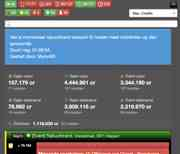

# Meldkamerspel Credits Totalen

Een onofficieel userscript voor **meldkamerspel.com** dat boven de meldingenlijst live credit-totalen toont.

## Voorbeeld

## Wat toont het?

Het dashboard toont:

- 🏠 Eigen open
- 👥 Team open
- 🎉 Event open
- 🏠 Eigen deelname
- 👤 Team deelname
- 🎉 Event deelname
- 👁 Zichtbaar — totaal van de meldingen die na je huidige filters daadwerkelijk zichtbaar zijn

De bedragen zijn gebaseerd op de gemiddelde credits van de inzet en zijn dus een indicatie, geen gegarandeerde uiteindelijke uitbetaling.

## Vereisten

- Een userscript-manager zoals **Tampermonkey**
- **LSSM is niet vereist**
- Het script is wel compatibel met LSSM en reageert op zichtbaarheid/filtering in de meldingenlijst

## Installatie

1. Installeer Tampermonkey in je browser.
2. Open Tampermonkey.
3. Kies **Nieuw script**.
4. Verwijder de standaardinhoud.
5. Kopieer de volledige inhoud van `meldkamerspel-credits-totalen.user.js`.
6. Plak die in Tampermonkey.
7. Sla op.
8. Herlaad `https://www.meldkamerspel.com/`.

Daarna verschijnt het credit-overzicht boven je meldingenlijst.

## Updaten

Als er een nieuwe versie verschijnt:

1. Open het script in Tampermonkey.
2. Vervang de bestaande code door de nieuwste versie.
3. Sla op.
4. Herlaad Meldkamerspel.

## Compatibiliteit

Het script leest informatie uit de DOM van Meldkamerspel. Als Meldkamerspel de structuur van de meldingenlijst wijzigt, kan het script tijdelijk niet meer correct werken.

LSSM is niet nodig, maar het script kan naast LSSM gebruikt worden.

## Disclaimer

Dit is een **onofficieel community-userscript**.

Het project is niet verbonden aan, goedgekeurd door of onderhouden door Meldkamerspel, XYRALITY of LSS-Manager.

## Licentie

MIT. Je mag de code gebruiken, kopiëren, aanpassen, publiceren, distribueren en er eigen versies van maken, zolang de MIT-licentietekst behouden blijft.
